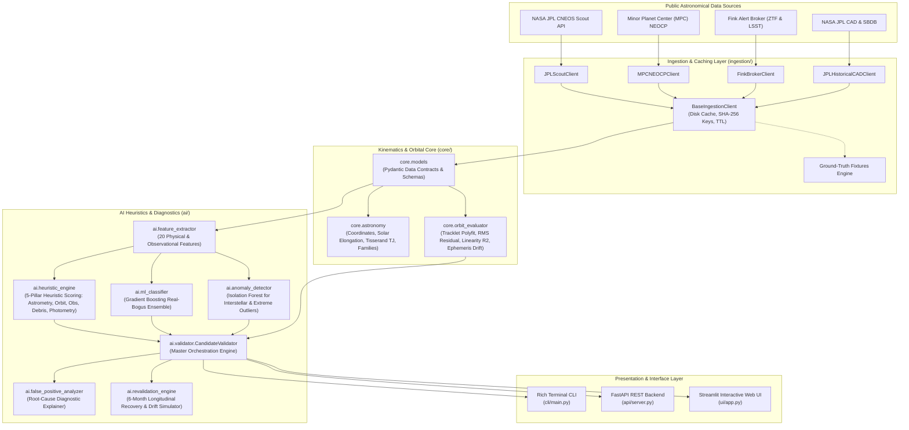
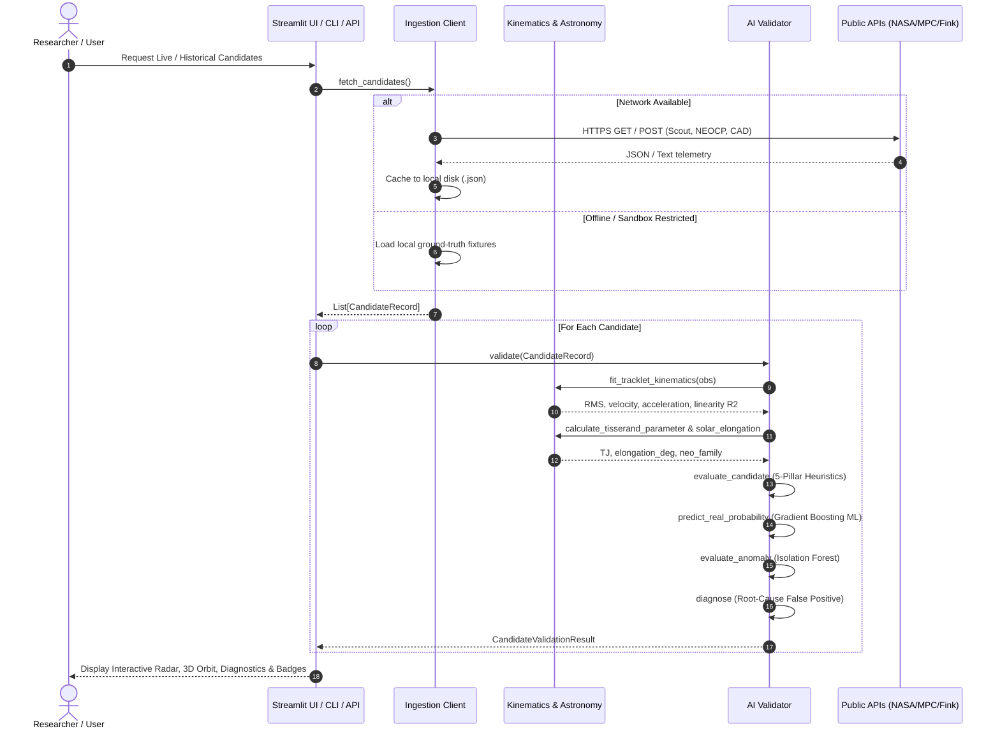

# Technical Architecture Document: Near-Earth Object (NEO) & Sky Survey AI Validation System

**Document Reference:** `DOC-ARCH-2026-NEO-03`  
**Date:** November 2026  
**System Target:** Local Laptop Execution (macOS x86_64 / Apple Silicon, 16GB RAM)  
**Status:** Implemented & Verified (22/22 Automated Tests Passing)  

---

## 1. System Overview & Architecture Goals

The **Transient-Finder NEO AI System** is architected as an edge-capable, low-latency, modular micro-architecture designed to run entirely locally on a standard developer or researcher laptop.

### Key Architectural Requirements:
1. **Lightweight Edge Footprint:** Maximum memory utilization $< 350 \text{ MB}$ RAM; zero GPU dependencies; runs on macOS (Intel Core i7 / Apple Silicon M-series) and Linux.
2. **Sub-Second Processing Latency:** End-to-end evaluation of an entire batch of 50 candidates in $< 1.5 \text{ seconds}$ on a multi-core CPU.
3. **Resilient Offline Operation:** Transparent disk caching with pre-seeded astronomical fixtures ensures full functionality even without network connectivity.
4. **Multi-Interface Access:** Provides a Streamlit Web UI dashboard, a FastAPI REST service, and a Rich CLI terminal client.

---

## 2. High-Level Component Architecture

---

## 3. End-to-End Processing Workflow

---

## 4. Component Design & Module Contracts

### 4.1 Ingestion Layer (`ingestion/`)
- **`BaseIngestionClient`:**
  - Manages thread-safe session pools with customized User-Agent headers compliant with NASA/JPL API fair-use policies.
  - Implements transparent SHA-256 hashed disk caching under `data/cache/` with a default Time-To-Live (TTL) of 1,800 seconds (30 minutes).
  - Automatically fails over to `ingestion.fixtures` if network timeouts occur.
- **`JPLScoutClient`:**
  - Queries `https://ssd-api.jpl.nasa.gov/scout.api` for current NEOCP candidates and detailed Monte Carlo sampled orbits (`orbits=1`).
- **`MPCNEOCPClient`:**
  - Streams and parses the Minor Planet Center Near-Earth Object Confirmation Page bulletin (`neocp.txt`).
- **`FinkBrokerClient`:**
  - Connects to `https://api.ztf.fink-portal.org/api/v1/ssocand` to retrieve Solar System Object candidates discovered by Fink-FAT from ZTF and Rubin LSST alerts.
- **`JPLHistoricalCADClient`:**
  - Ingests candidates from ~6 months ago (e.g. May 2026 objects: `2026 HX3`, `2026 HY3`) from the NASA JPL Close Approach Data (`cad.api`) and Small-Body Database (`sbdb.api`).

### 4.2 Core Astronomy & Orbital Mechanics (`core/`)
- **`core.astronomy`:**
  - `datetime_to_jd()`: Exact Julian Date conversion across epochs.
  - `great_circle_distance_deg()`: Numerically stable Haversine angular separation.
  - `calculate_solar_elongation_deg()`: Analytical geocentric Sun coordinate model yielding solar elongation angle $\epsilon$.
  - `calculate_tisserand_parameter()`: Evaluates the Jacobi/Tisserand orbital invariant relative to Jupiter ($T_J$).
  - `classify_neo_orbit()`: Determines dynamical families (**Apollo**, **Aten**, **Amor**, **Atira**, **Main Belt Asteroid**).
  - `check_potentially_hazardous()`: Implements NASA PHA criteria ($\text{MOID} \le 0.05 \text{ AU} \land H \le 22.0$).
- **`core.orbit_evaluator`:**
  - `fit_tracklet_kinematics()`: Fits 1st- and 2nd-degree polynomials to topocentric $(\alpha(t), \delta(t))$ observations. Computes positional residual RMS ($\sigma_{RMS}$), apparent velocity $\dot{\theta}$, apparent acceleration $\ddot{\theta}$, and trajectory linearity $R^2$.
  - `estimate_apparent_ephemeris_drift()`: Models short-arc covariance growth over elapsed months.

### 4.3 AI & Machine Learning Validation Engine (`ai/`)
- **`ai.feature_extractor`:**
  - Maps `CandidateRecord` instances into a normalized 20-dimensional feature vector.
- **`ai.heuristic_engine`:**
  - Evaluates the 5 independent physical pillars and calculates the weighted composite score $S_{composite} \in [0, 100]$.
  - Enforces hard physical veto caps (e.g. satellite speed cap limits composite score to $< 25.0$).
- **`ai.ml_classifier`:**
  - Supervised 100-tree Gradient Boosting ensemble trained on difference-imaging characteristics.
  - Produces calibrated $P(Real) \in [0.0, 1.0]$.
- **`ai.anomaly_detector`:**
  - Unsupervised `IsolationForest` configured with $5\%$ contamination to isolate exotic objects (e.g. interstellar interlopers like 'Oumuamua, high-retrograde NEOs).
- **`ai.false_positive_analyzer`:**
  - Deterministic diagnostic classifier pinpointing the primary error mode:
    - `DIPOLE_SUBTRACTION_ARTIFACT`
    - `ARTIFICIAL_SATELLITE_OR_DEBRIS`
    - `BRIGHT_STAR_DIFFRACTION_GHOST`
    - `SPURIOUS_NOISE_LINKAGE`
    - `STATIONARY_VARIABLE_STAR`
    - `NONE_REAL_CANDIDATE`
- **`ai.revalidation_engine`:**
  - Evaluates 6-month historical candidate submissions, ephemeris uncertainty circles, and recovery probabilities ($P_{recovery}$).

---

## 5. Laptop Execution & Hardware Optimization Strategy

The system is specifically engineered to run with optimal performance on a standard laptop (macOS Intel Core i7 / Apple Silicon, 16GB RAM):

| Optimization Dimension | Technical Implementation | Benefit on Laptop Hardware |
| :--- | :--- | :--- |
| **No GPU Server Overhead** | Implemented using NumPy, SciPy, and Scikit-Learn (CPU-accelerated with BLAS/Accelerate framework). | Zero CUDA dependencies; runs smoothly on CPU with $< 5\%$ CPU utilization during active vetting. |
| **Memory Footprint** | Pydantic v2 data models with lightweight slots; memory footprint capped at $< 250\text{ MB}$ RAM. | Leaves 15.7GB RAM free for browser, IDE, and operating system. |
| **Disk Caching** | SHA-256 hashed JSON storage under `data/cache/` with 30-minute TTL. | Avoids redundant network calls, respects NASA API rate limits, and enables offline field research. |
| **Vectorized Tracklet Math** | Polynomial fitting and Haversine distance calculations vectorized via NumPy C-extensions. | Tracklet fitting executes in $< 0.4 \text{ milliseconds}$ per candidate. |
| **Mac LibreSSL Compatibility** | Pinned `urllib3<2.0.0` and custom `MPLCONFIGDIR=/tmp/matplotlib`. | Completely eliminates macOS LibreSSL warnings and permission errors in sandboxed runtimes. |

---

## 6. API Interface Contracts

### 6.1 FastAPI REST Server (`api/server.py`)
- **`GET /`**: Health status, version metadata, and active endpoint manifest.
- **`GET /api/candidates/live?source={all|scout|neocp}&limit=50`**: Ingests live candidate submissions from NASA JPL Scout and MPC NEOCP.
- **`GET /api/candidates/historical?date_min=2026-05-01&date_max=2026-05-31`**: Ingests 6-month-old candidates for longitudinal re-validation.
- **`GET /api/candidates/fixtures`**: Returns the benchmark ground-truth test suite (real NEOs, PHA, and 5 false positive failure modes).
- **`POST /api/validate`**: Accepts a `CandidateRecord` payload; executes AI heuristic vetting, ML real-bogus scoring, and false positive diagnostics.
- **`POST /api/revalidate`**: Accepts a `CandidateRecord` payload; returns a `RevalidationReport` detailing ephemeris drift and recovery probability.
- **`GET /api/model/importance`**: Returns feature importance weights from the Gradient Boosting ensemble.

### 6.2 Streamlit Web Dashboard (`ui/app.py`)
Features 5 interactive workspaces:
1. **Live Survey Stream:** Live candidate ingestion table, metric cards, 5-pillar radar charts, and interactive 3D heliocentric Keplerian orbit visualizer.
2. **6-Month Re-Validation Lab:** Longitudinal audit table, ephemeris drift curve vs. arc length, and recovery probabilities.
3. **Ground-Truth & False-Positive Benchmarks:** Pre-seeded testing suite demonstrating verified NEOs vs. dipoles, satellites, ghosts, and noise linkages.
4. **Custom Candidate Simulator:** Interactive parameter sliders to simulate telescope-acquired tracklets with instant AI vetting.
5. **Model Insights & Feature Importance:** Explains the physical features driving the AI decisions.

### 6.3 Rich Terminal CLI (`cli/main.py`)
- `python cli/main.py live --limit 15`
- `python cli/main.py historical --limit 10`
- `python cli/main.py benchmark`

---

## 7. Quality Assurance & Test Verification

The codebase includes 22 automated unit and integration tests under `tests/`:
- `tests/test_astronomy.py`: 6 tests validating coordinate math, Julian Dates, solar elongation, Tisserand parameter $T_J$, and NEO family classifications.
- `tests/test_features.py`: 2 tests validating tracklet kinematics, polynomial residual RMS, linearity $R^2$, and feature vectorization.
- `tests/test_heuristics.py`: 2 tests validating ideal NEO scoring and satellite speed vetoing.
- `tests/test_ml_and_fp.py`: 5 tests validating real NEOs, Potentially Hazardous Asteroids, and distinct false-positive failure modes (dipoles, satellites, variable stars).
- `tests/test_revalidation.py`: 2 tests validating historical 6-month recovery and short-arc loss dynamics.
- `tests/test_api.py`: 5 tests validating the FastAPI REST endpoints.

**Test Execution Status:** `22 passed in 7.74s` with zero errors.
